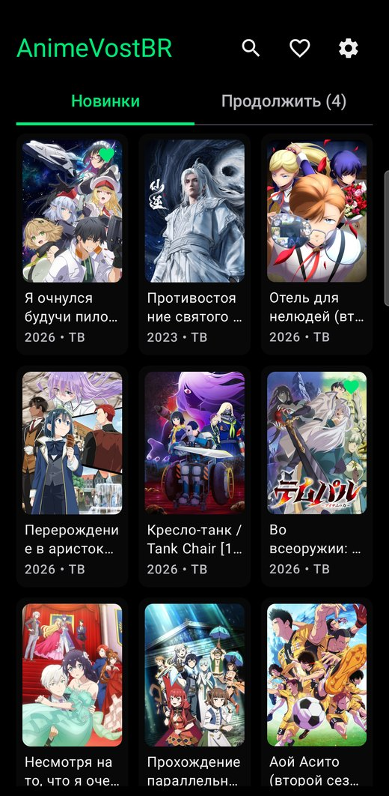
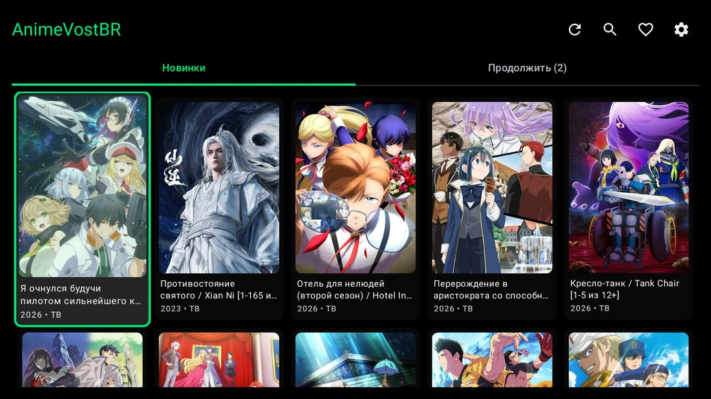
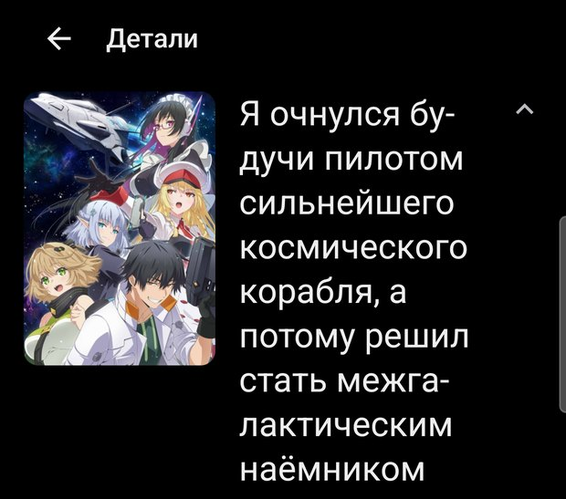
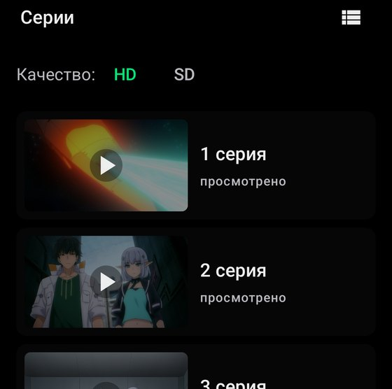
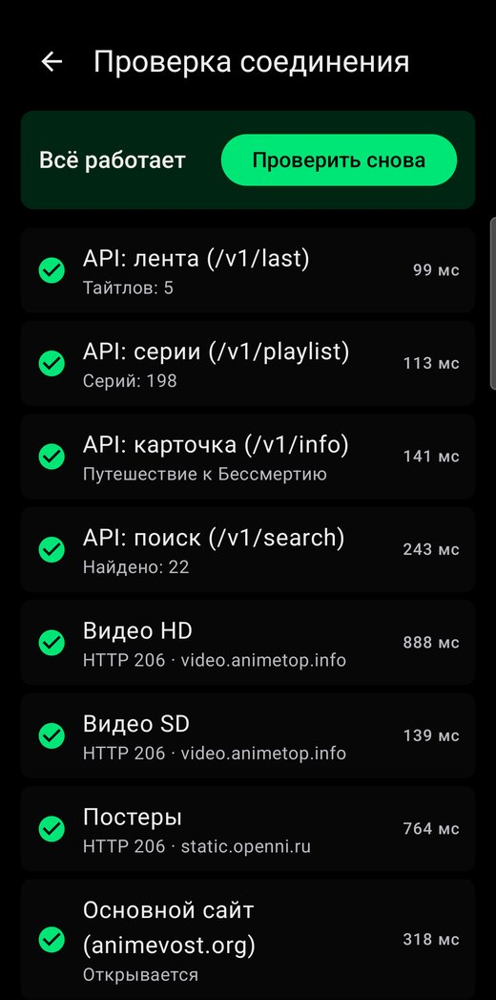
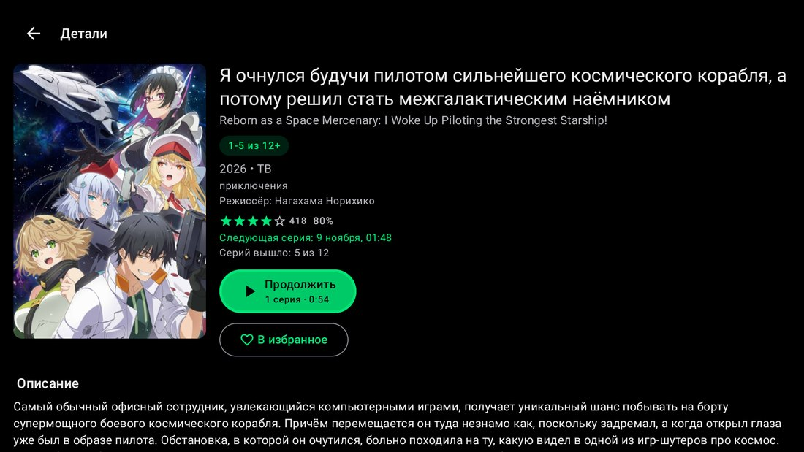
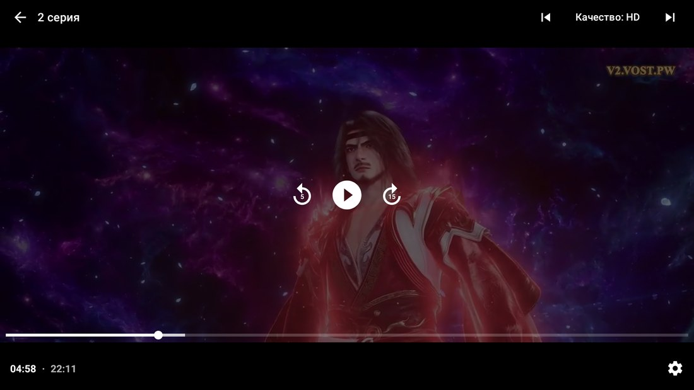
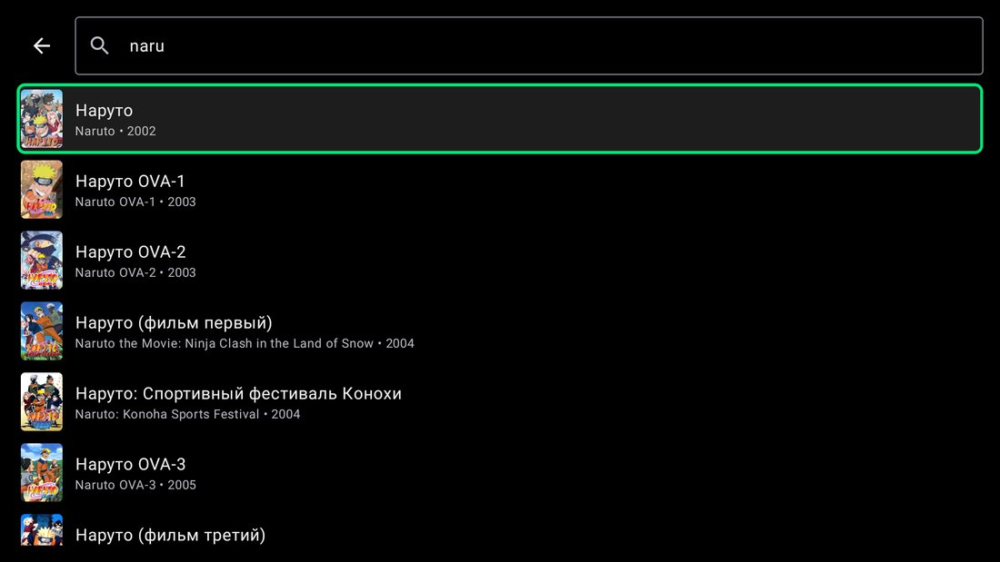
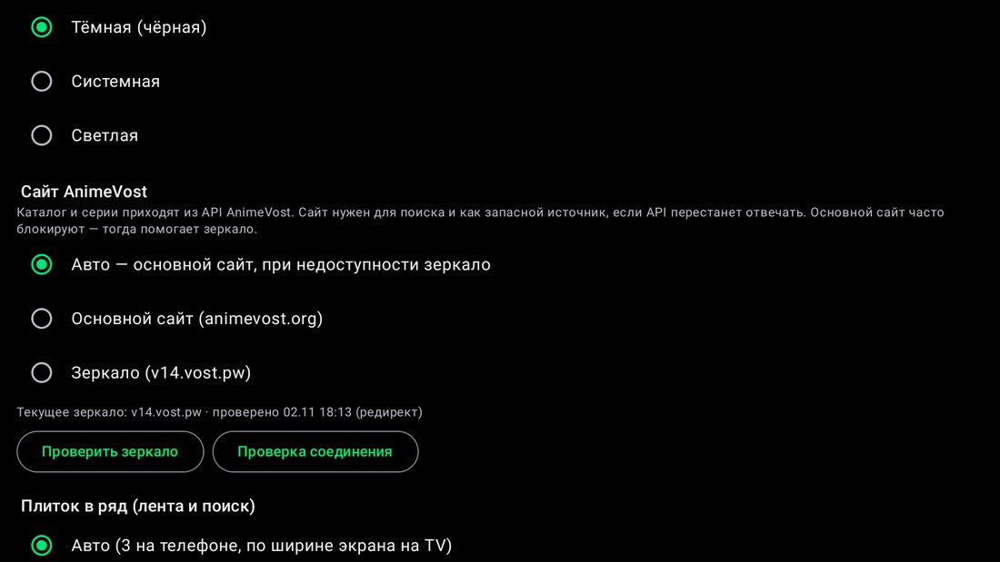

<p align="center">
  
</p>

<h1 align="center">AnimeVostBR</h1>

<p align="center">
  Неофициальный клиент <a href="https://animevost.org">AnimeVost</a> для Android-телефонов, планшетов и Android TV
</p>

<p align="center">
  <a href="https://github.com/Maxic112/AnimeVostBR/releases/latest"></a>
  <a href="https://github.com/Maxic112/AnimeVostBR/actions/workflows/build.yml"></a>
  
  <a href="LICENSE"></a>
</p>

---

**AnimeVostBR** — приложение для просмотра аниме с русской озвучкой [AnimeVost](https://animevost.org).
Один и тот же APK работает на телефоне, планшете и телевизоре: на телефоне — жесты и сетка плиток,
на Android TV — управление пультом и крупный интерфейс.

<p align="center">
  
  &nbsp;
  
</p>

## Возможности

- **Лента обновлений** — новые серии сверху, бесконечная прокрутка, обновление свайпом вниз (кнопкой на TV).
- **Поиск с подсказками** — варианты появляются прямо во время ввода, по русскому и английскому названию.
- **Жанры, типы и годы** — выборки как на сайте: «Драма», «OVA», «2024» и т. д.
- **Плитки или список** — лента сеткой постеров с рейтингом или списком с описанием и кнопкой «Смотреть»; размер плиток и превью настраивается.
- **Встроенный плеер** — Full HD (1080p), HD (720p) и SD (480p), перемотка двойным тапом и растягивание на весь экран щипком как в YouTube, автопереход к следующей серии, автоматическое переключение на качество ниже, если выбранное недоступно.
- **«Продолжить просмотр»** — приложение помнит серию и место остановки; отдельная вкладка с удалением.
- **Избранное и уведомления** о новых сериях избранных тайтлов.
- **Android TV** — полное управление пультом, заметная рамка фокуса, баннер в лаунчере.
- **Список серий** простыми названиями или с кадрами-превью.
- **Сайт и зеркало** — выбор основного сайта или зеркала; адрес зеркала обновляется автоматически.
- **Резервный режим** — если сервер каталога недоступен, данные берутся напрямую с сайта.
- **Проверка соединения** — экран, который показывает, что именно не работает: сервер каталога, видео, сайт или зеркало.
- **Обновление из приложения** — новая версия скачивается с GitHub Releases и ставится в пару нажатий; проверка раз в сутки, о новой версии напомнит оранжевая точка на значке настроек.
- Без рекламы, аккаунтов и сбора данных: избранное и прогресс хранятся только на устройстве.

## Скриншоты

| Телефон | | |
|:---:|:---:|:---:|
|  |  |  |
| Страница тайтла | Серии с превью | Проверка соединения |

| Android TV | |
|:---:|:---:|
|  |  |
| Страница тайтла | Плеер |
|  |  |
| Поиск с подсказками | Выбор сайта и зеркала |

## Скачать и установить

Приложения нет в Google Play — оно распространяется через [GitHub Releases](https://github.com/Maxic112/AnimeVostBR/releases/latest).

1. Откройте страницу [последнего релиза](https://github.com/Maxic112/AnimeVostBR/releases/latest) и скачайте файл `AnimeVostBR-v<версия>.apk` из раздела **Assets**.
2. **Телефон или планшет:** откройте скачанный файл, разрешите установку из этого источника («Установка неизвестных приложений») и нажмите «Установить».
3. **Android TV:** перенесите APK на телевизор (флешка, облако или приложение для передачи файлов), откройте его в файловом менеджере и разрешите установку из неизвестных источников для этого менеджера.
4. **Обновление:** начиная с версии 1.3.0 — **Настройки → Обновление → «Установить»**. В более старых версиях скачайте новый APK и поставьте поверх старого. Избранное, прогресс и настройки сохранятся.

**Требования:** Android 8.0 или новее (телефоны, планшеты, Android TV / Google TV); любой процессор.

Подробная инструкция со скриншотами — в [руководстве пользователя](docs/user-guide.md).

## Документация

| Документ | Содержание |
|---|---|
| [Руководство пользователя](docs/user-guide.md) | Установка, интерфейс, плеер, управление пультом, настройки, решение проблем |
| [Техническая документация](docs/technical.md) | Архитектура, источники данных, сайт и зеркало, хранение данных, сборка, подпись, CI/CD |
| [API AnimeVost](docs/api.md) | Эндпоинты, форматы ответов и их особенности, разметка сайта для резервного режима |
| [Changelog](CHANGELOG.md) | История версий |
| [Contributing](CONTRIBUTING.md) | Как предложить изменения |

## Сборка из исходников

Нужны JDK 17 и Android SDK (platform 34).

```bash
./gradlew testDebugUnitTest assembleDebug
```

Отладочный APK появится в `app/build/outputs/apk/debug/`. Подписанный release-APK собирается
локально скриптом `tools/build_release.sh` или автоматически в GitHub Actions при публикации тега
`v*` — подробности в [технической документации](docs/technical.md#сборка-подпись-и-релизы).

## Правовая информация

AnimeVostBR — неофициальное приложение, не связанное с администрацией AnimeVost. Весь видеоконтент
принадлежит правообладателям; приложение не хранит и не распространяет медиафайлы, а только
отображает материалы публичного сайта [animevost.org](https://animevost.org). Возрастное ограничение
контента — 16+.

Исходный код распространяется по лицензии [MIT](LICENSE).
