# Руководство пользователя AnimeVostBR

AnimeVostBR — неофициальный клиент сайта [AnimeVost](https://animevost.org) для просмотра аниме с
русской озвучкой. Одно приложение работает на телефонах, планшетах и Android TV.

## Содержание

1. [Требования](#требования)
2. [Установка на телефон](#установка-на-телефон)
3. [Установка на телевизор](#установка-на-телевизор)
4. [Главный экран](#главный-экран)
5. [Поиск](#поиск)
6. [Страница тайтла](#страница-тайтла)
7. [Плеер на телефоне](#плеер-на-телефоне)
8. [Плеер на телевизоре](#плеер-на-телевизоре)
9. [«Продолжить просмотр» и избранное](#продолжить-просмотр-и-избранное)
10. [Уведомления о новых сериях](#уведомления-о-новых-сериях)
11. [Сайт, зеркало и проверка соединения](#сайт-зеркало-и-проверка-соединения)
12. [Обновление приложения](#обновление-приложения)
13. [Настройки](#настройки)
14. [Вопросы и решения проблем](#вопросы-и-решения-проблем)

## Требования

| Устройство | Требования |
|---|---|
| Телефон или планшет | Android 8.0 или новее, около 30 МБ свободного места |
| Телевизор / приставка | Android TV / Google TV на Android 8.0 или новее, пульт |
| Интернет | Для HD желательно от 5 Мбит/с, для SD достаточно 2 Мбит/с |

## Установка на телефон

Приложения нет в Google Play — APK скачивается со страницы
[GitHub Releases](https://github.com/Maxic112/AnimeVostBR/releases/latest) (файл `AnimeVostBR-v<версия>.apk`
в разделе **Assets**).

1. Скачайте APK на телефон (или перенесите его через облако, мессенджер, USB-кабель).
2. Откройте файл из уведомления о загрузке или из файлового менеджера (папка «Загрузки»).
3. Android попросит разрешение «Установка неизвестных приложений»: нажмите **«Настройки»** → включите
   **«Разрешить из этого источника»** → вернитесь назад.
4. Нажмите **«Установить»**. Если появится предупреждение Google Play Защиты, выберите
   **«Подробнее» → «Всё равно установить»**.
5. При первом запуске разрешите уведомления, если хотите узнавать о новых сериях.

> **Обновление.** С версии 1.3.0 приложение обновляется само — см.
> [Обновление приложения](#обновление-приложения). Удалять приложение не нужно: избранное, прогресс
> и настройки сохранятся.

## Установка на телевизор

На телевизоре нужен файловый менеджер — встроенный или любой из магазина приложений.

**Через флешку**

1. Скопируйте APK на флешку и вставьте её в телевизор.
2. Откройте файловый менеджер, найдите файл и нажмите **OK**.
3. Разрешите установку из этого приложения: **Настройки → Безопасность → Неизвестные источники** —
   включите для файлового менеджера.
4. Вернитесь и нажмите **«Установить»**.

**По сети** — передайте файл приложением для отправки файлов на телевизор или откройте его из облака
через файловый менеджер, дальше — как в шагах 2–4.

После установки приложение появится в списке приложений телевизора с баннером:

## Главный экран

Сверху — название и кнопки **Поиск**, **Избранное**, **Настройки** (на телевизоре ещё **Обновить**).
Ниже две вкладки, они переключаются свайпом или нажатием:

- **Новинки** — тайтлы в порядке обновления: где вышла новая серия, тот и сверху;
- **Продолжить** — начатые тайтлы (см. [ниже](#продолжить-просмотр-и-избранное)).

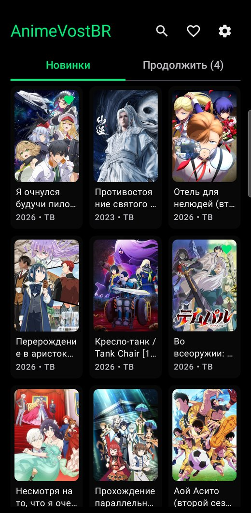

- **Тап** по карточке открывает страницу тайтла.
- **Долгое нажатие** добавляет тайтл в избранное или убирает из него (зелёное сердечко на постере).
- Лента подгружается сама при прокрутке — до самых старых тайтлов.
- Количество плиток в ряду (2–5) меняется в настройках.

**Обновление ленты.** На телефоне потяните ленту вниз, на телевизоре нажмите кнопку **Обновить** в
шапке. Внизу появится подсказка: «Обновлено: новых серий и тайтлов — N», «Новых серий пока нет» или
«Не удалось обновить: нет соединения».

| Телефон | Телевизор |
|:---:|:---:|
| 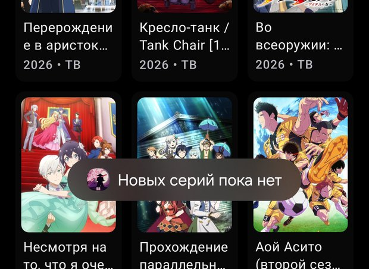 | 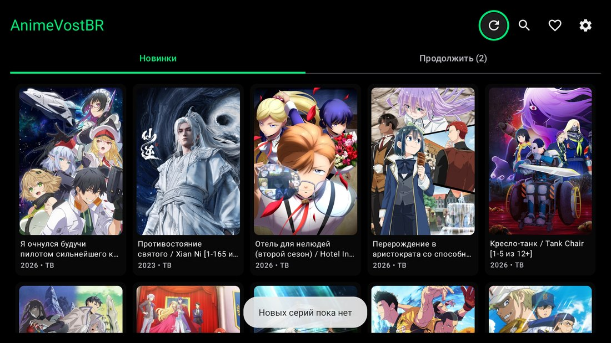 |

## Поиск

1. Нажмите **Поиск** — курсор сразу встанет в поле ввода.
2. Начните вводить русское или английское название. Со второй буквы появятся подсказки с постерами;
   нажмите на нужную — откроется тайтл.
3. Чтобы увидеть все результаты сеткой, нажмите кнопку поиска на клавиатуре.

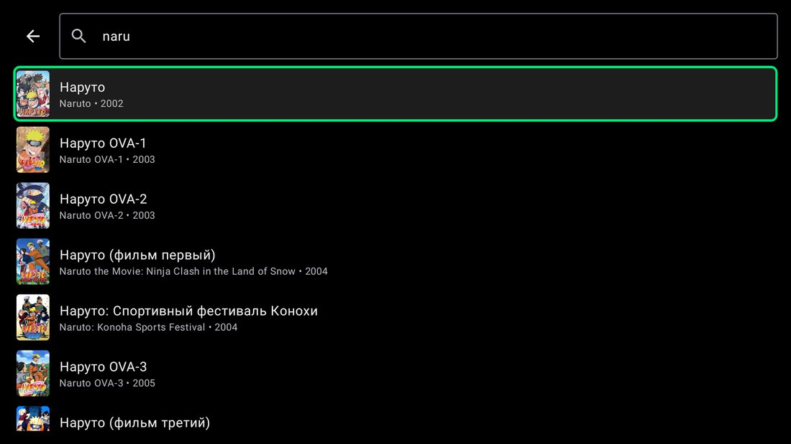

**Советы**

- Достаточно части названия: «нару» найдёт все тайтлы «Наруто».
- Регистр не важен; знаки препинания лучше не вводить («ван пис», а не «Ван-Пис»).
- Если по названию ничего не нашлось, приложение само выполнит полнотекстовый поиск по сайту.

**На телевизоре** открывается экранная клавиатура; на многих из них есть кнопка микрофона для
голосового ввода. Чтобы перейти от поля к результатам, нажмите **Назад** (спрячет клавиатуру) и **↓**.

## Страница тайтла

**Название.** Русское название — крупно, английское — ниже. Сведения из скобок показываются плашками:
сколько серий вышло и когда следующая. Если название не помещается, справа появляется стрелка —
нажмите на название, чтобы раскрыть его целиком.

| Свёрнуто | Развёрнуто |
|:---:|:---:|
| 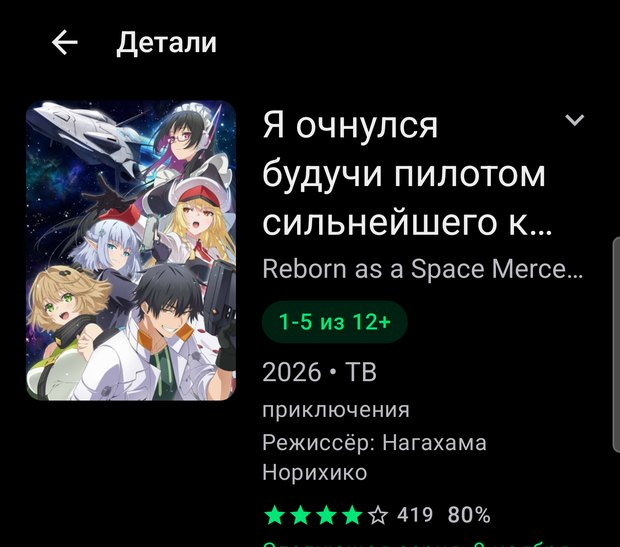 | 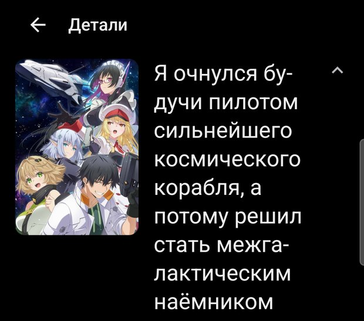 |

**Кнопка «Смотреть» / «Продолжить»** сама выбирает серию: начатую — с места остановки, досмотренную —
следующую, новый тайтл — с первой серии. Ниже — кнопка «В избранное», рейтинг, жанры, режиссёр,
дата следующей серии и описание.

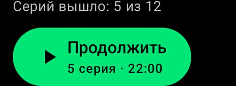

**Серии и качество.** Над списком выбирается качество: **HD** (720p) или **SD** (480p, меньше трафика).
Значок справа от заголовка «Серии» переключает вид списка: названия или кадры-превью.

| Названиями | С превью |
|:---:|:---:|
| 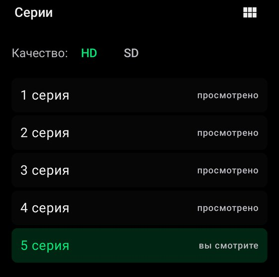 | 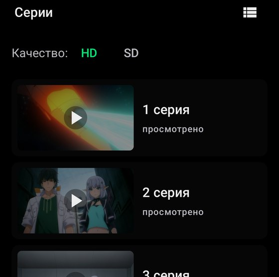 |

Серии называются так же, как на сайте: «5 серия», «215-216 серия», «ОВА 1», «Фильм».

## Плеер на телефоне

Видео открывается на весь экран, системные панели прячутся (вернуть — свайп от края экрана).

| Действие | Результат |
|---|---|
| Тап по видео | Показать или спрятать кнопки; через несколько секунд они прячутся сами |
| Двойной тап справа | Вперёд на 10 секунд; каждый следующий тап по той же стороне — ещё +10 |
| Двойной тап слева | Назад на 10 секунд, так же накапливается |
| Полоса внизу | Точная перемотка |
| ⏮ / ⏭ вверху | Предыдущая / следующая серия |
| «Качество» вверху | Переключить HD ↔ SD с того же места |
| Шестерёнка внизу | Скорость воспроизведения |

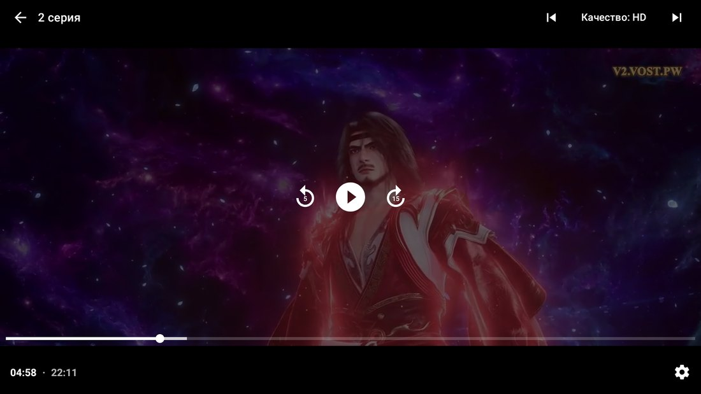

- В конце серии автоматически включается следующая.
- Место остановки сохраняется каждые 5 секунд — приложение можно просто закрыть.
- Если у серии нет HD (бывает у старых тайтлов), плеер сам переключится на SD и сообщит об этом.

## Плеер на телевизоре

Всё управляется пультом; выбранный элемент обведён зелёной рамкой.

| Кнопка пульта | Действие |
|---|---|
| OK | Пауза / продолжить, показать полосу времени |
| ← / → | Перемотка на 10 секунд; нажатия подряд складываются, удержание — быстрая перемотка |
| ↑ | Перейти на верхнюю панель: Назад, ⏮, Качество, ⏭ |
| ↓ | С панели — обратно к видео |
| Назад | Сначала прячет панели, повторно — выход из плеера |
| ⏭ / ⏮, CH+ / CH− | Следующая / предыдущая серия |

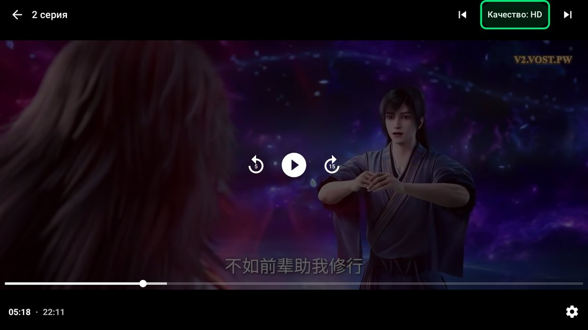

На главном экране при запуске выбрана первая карточка, а после возврата со страницы тайтла — та же,
что была. На странице тайтла фокус сразу стоит на кнопке «Смотреть» / «Продолжить».

## «Продолжить просмотр» и избранное

**Вкладка «Продолжить»** — все начатые тайтлы, последний просмотренный сверху, с номером серии и
временем остановки. Крестик убирает тайтл из списка, «Очистить всё» — убирает всё (с подтверждением).

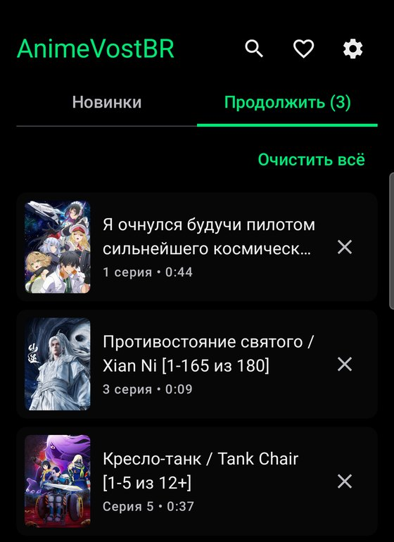

**Избранное**

- добавить: долгое нажатие на карточку или кнопка «В избранное» на странице тайтла;
- посмотреть: кнопка с сердечком на главном экране;
- убрать: крестик в списке избранного или повторное нажатие кнопки на странице тайтла.

## Уведомления о новых сериях

Раз в 30 минут (при наличии интернета) приложение проверяет новые серии у тайтлов из избранного и
присылает уведомление «Вышла N серия». Нажатие открывает страницу тайтла.

- Включаются в **Настройки → Уведомления о новых сериях**; на телефоне нужно разрешение Android.
- Сразу после добавления в избранное запоминается текущее число серий — уведомление придёт со
  следующей серией.
- Если уведомления не приходят, проверьте, что для приложения не включён строгий режим экономии
  батареи.

## Сайт, зеркало и проверка соединения

Каталог и серии приходят с сервера AnimeVost (API). Сайт нужен для поиска и как **запасной источник**:
если сервер каталога перестанет отвечать, приложение само возьмёт ленту, описания и серии с сайта.
Основной сайт часто блокируют, поэтому у него есть **зеркало**, адрес которого время от времени меняется.

**Настройки → Сайт AnimeVost:**

- **Авто** (рекомендуется) — основной сайт, а если он не открывается — зеркало;
- **Основной сайт** — только animevost.org;
- **Зеркало** — только зеркало (если основной сайт заблокирован у провайдера).

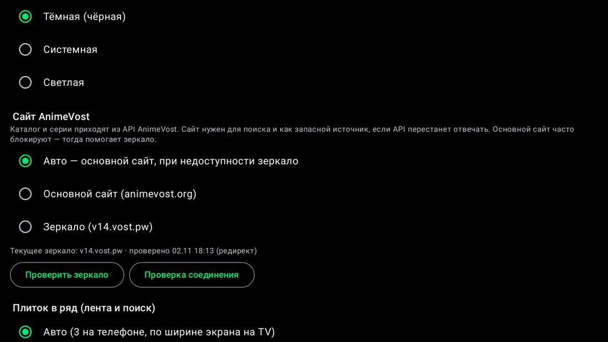

**Зеркало обновляется само**: при запуске и раз в несколько часов приложение проверяет, не переехал
ли сайт, и сохраняет новый адрес. Кнопка **«Проверить зеркало»** делает проверку сразу.

**Резервный режим.** Если сервер каталога недоступен, над лентой появится строка
«API не отвечает — данные с сайта …». Смотреть можно как обычно; не будет только рейтинга.

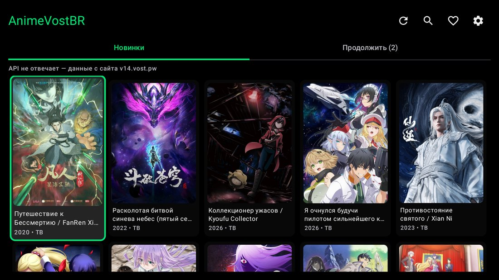

**Проверка соединения** — кнопка в настройках. Экран по очереди проверяет сервер каталога (ленту,
серии, карточку, поиск), видеосервер (HD и SD), картинки, основной сайт, зеркало и запасной источник.
У каждого пункта — отметка (работает / замечания / не работает), время ответа и пояснение, сверху — итог.

| Всё работает | Сервер каталога недоступен |
|:---:|:---:|
| 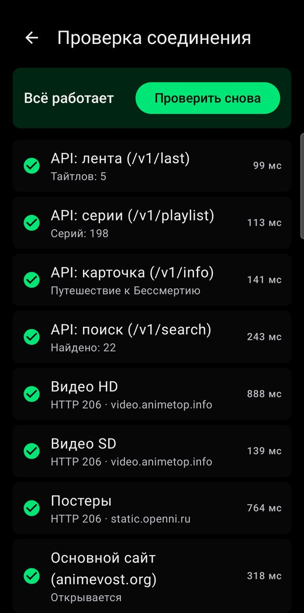 | 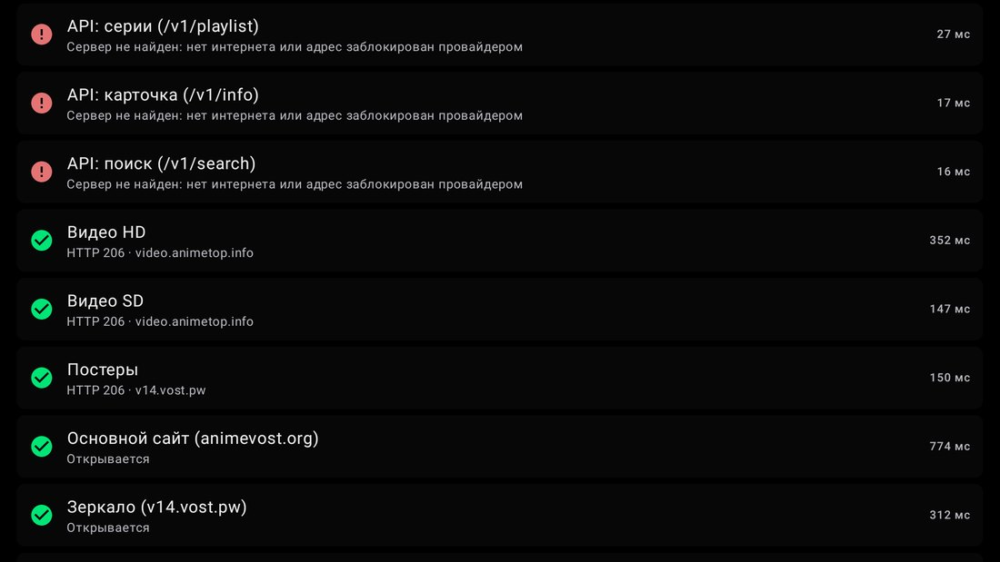 |

## Обновление приложения

Новые версии публикуются на [GitHub Releases](https://github.com/Maxic112/AnimeVostBR/releases), и
приложение умеет ставить их само.

- **Раз в сутки** приложение проверяет, вышла ли новая версия. Если вышла, на значке настроек на
  главном экране и на пункте **«Обновление»** в настройках появляется **оранжевая точка**.
- **Настройки → Обновление** — проверка выполняется сразу при открытии. Экран показывает установленную
  и новую версию, дату выпуска, размер и список изменений.
- Нажмите **«Установить»**. В первый раз Android попросит разрешить AnimeVostBR установку приложений:
  включите переключатель у AnimeVostBR и вернитесь в приложение. Android при этом перезапускает
  приложение — оно само откроет экран обновления и продолжит загрузку.
- После загрузки откроется системный установщик — нажмите **«Установить»**. Избранное, прогресс и
  настройки сохранятся.

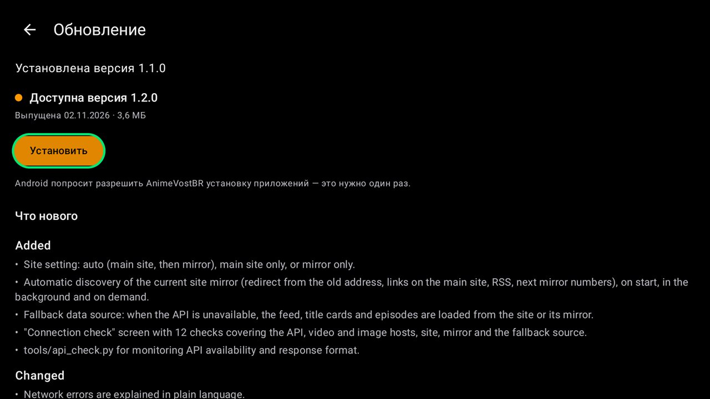

Перед установкой приложение проверяет, что файл — действительно AnimeVostBR, новее установленной
версии и подписан тем же ключом. Если что-то не так, на экране появится объяснение.

## Настройки

| Пункт | Варианты |
|---|---|
| Обновление | Проверка новой версии на GitHub и установка |
| Оформление | Тёмная (по умолчанию), Системная, Светлая |
| Сайт AnimeVost | Авто, Основной сайт, Зеркало; «Проверить зеркало», «Проверка соединения» |
| Плиток в ряд | Авто (3 на телефоне, по ширине экрана на TV) или 2–5; действует на ленту и поиск |
| Список серий | Названиями или с кадрами-превью |
| Качество по умолчанию | HD (720p) или SD (480p) |
| Уведомления | Включить / выключить проверку новых серий |

## Вопросы и решения проблем

| Проблема | Что делать |
|---|---|
| «Не удалось загрузить ленту» | Проверьте интернет и нажмите «Повторить». Откройте **Проверку соединения** — она покажет, что не работает. Если заблокирован основной сайт, выберите «Зеркало»; если не работает ничего — нужна другая сеть или VPN |
| Над лентой «API не отвечает — данные с сайта» | Сервер каталога временно недоступен, приложение работает через сайт. Смотреть можно как обычно |
| Видео не запускается | Нажмите «Повторить», переключите качество на SD. Если серия не работает ни в каком качестве — файла нет на сервере сайта |
| «HD недоступно — включено SD» | Нормально: у некоторых старых серий есть только SD |
| Видео тормозит | Выберите SD — ему нужен примерно вдвое меньший канал |
| «Серии не найдены» | Тайтл ещё не озвучен или временно недоступен на сайте |
| Поиск ничего не находит | Введите часть названия без знаков препинания или английское название |
| «Приложение не установлено» или «Обновление подписано другим ключом» | Установлена версия с другой подписью (например, из другого источника). Удалите её и установите APK с GitHub Releases — избранное и прогресс при этом пропадут |
| «Не удалось проверить обновления» | Нет доступа к github.com: проверьте интернет или попробуйте позже |
| APK не устанавливается | Устройство на Android 7.1 или старше — нужна версия 8.0+ |

Избранное, прогресс и настройки хранятся только на устройстве и не синхронизируются между телефоном
и телевизором.
